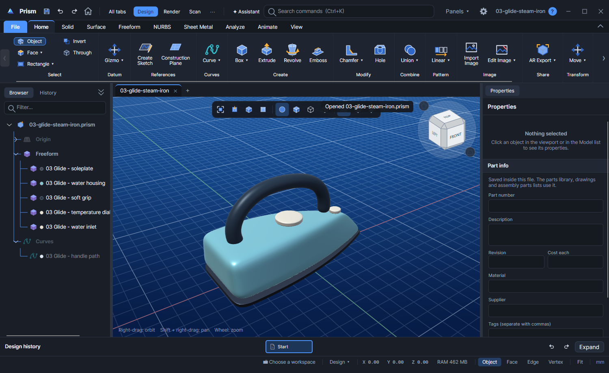
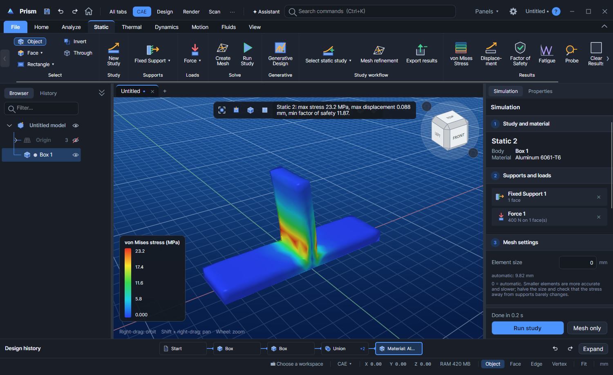

<p align="center">
  
</p>

<p align="center">
  <strong>Design it. Prove it. Make it.</strong><br>
  One desktop CAD application for solids, surfaces, freeform shapes and sketches,<br>
  with simulation, CNC, 3D printing, rendering and Python built in.
</p>

<p align="center">
  <a href="https://chrizpro.github.io/prism/">Website</a> ·
  <a href="https://chrizpro.github.io/prism/download">Download</a> ·
  <a href="https://chrizpro.github.io/prism/docs/">Documentation</a> ·
  <a href="https://chrizpro.github.io/prism/docs/tools/">Tool reference</a> ·
  <a href="https://chrizpro.github.io/prism/docs/api/">Scripting &amp; API</a>
</p>



> **Development preview.** Prism's feature set is in place and we are now polishing it. Expect rough edges, and keep backups of your models.

## What's inside

| Workspace | What you can do |
| --- | --- |
| **Design** | Parametric solids with an editable history, sketches with constraints, surfaces and NURBS, subdivision freeform, direct editing, sheet metal, engineering drawings |
| **Assemble** | Parts library, joints, mates, couplings, motion, exploded views, parts lists |
| **CAE** | Static stress, thermal, natural frequencies, mechanism motion, pipe flow and basic 3D flow |
| **CAM** | Three-axis CNC toolpaths with playback and G-code, plus FDM and resin print preparation |
| **Render** | Physically based materials, lights, realistic pictures and AR export to your phone |
| **Scan** | Mesh repair and reverse engineering from scans |
| **ECAD** | Boards, component envelopes and enclosure fit checks |
| **Script** | Python with the `cadkit` library, an HTTP API, and an MCP bridge for AI assistants |

Every tool has a page in the [tool reference](https://chrizpro.github.io/prism/docs/tools/).



## Download

Get the installer for your system from the [download page](https://chrizpro.github.io/prism/download) or [GitHub Releases](https://github.com/chrizpro/prism/releases):

| System | File |
| --- | --- |
| Windows 10 and 11 (x64) | `Prism-windows-x64-Setup.exe` |
| macOS, Apple silicon | `Prism-macos-arm64.dmg` |
| macOS, Intel | `Prism-macos-x64.dmg` |
| Linux (Debian, Ubuntu) | `Prism-linux-x64.deb` |

Preview builds are not code-signed yet. On Windows, choose **More info › Run anyway** if SmartScreen warns you. On macOS, right-click Prism and choose **Open** the first time. See the [install guide](https://chrizpro.github.io/prism/docs/download) for details.

## Run Prism from a fork

You can build and run Prism from your own fork on Windows, macOS or Linux.

### 1. Fork and clone

Click **Fork** at the top of this page, then clone your fork:

```bash
git clone https://github.com/<your-account>/prism.git
cd prism
```

### 2. Install the tools

- [.NET 10 SDK](https://dotnet.microsoft.com/download)
- [PowerShell 7](https://learn.microsoft.com/powershell/scripting/install/installing-powershell) (the build scripts use it on every system)
- CMake and a C++ compiler: Visual Studio Build Tools with the C++ workload on Windows, Xcode command-line tools on macOS, or `build-essential` on Linux
- [vcpkg](https://github.com/microsoft/vcpkg) for the native geometry and simulation libraries

On Linux, also install the tools and libraries the native build needs:

```bash
sudo apt-get install -y autoconf autoconf-archive automake libtool pkg-config ninja-build libx11-dev libxrandr-dev libxi-dev libxinerama-dev libxcursor-dev libgl1-mesa-dev
```

On macOS, install the autotools vcpkg uses with [Homebrew](https://brew.sh):

```bash
brew install autoconf autoconf-archive automake libtool pkg-config
```

### 3. Build the native libraries

Prism uses Open CASCADE, Eigen and Netgen. Install them with vcpkg at the version the release builds use, then build Prism's native layer. Pick the triplet for your system: `x64-windows-release`, `arm64-osx-dynamic` (Apple silicon), `x64-osx-dynamic` (Intel Mac) or `x64-linux-dynamic`.

```powershell
git clone https://github.com/microsoft/vcpkg.git ../vcpkg
git -C ../vcpkg checkout 817892b0ecbc6af994dd6df999c73faf795adbf2
../vcpkg/bootstrap-vcpkg.sh -disableMetrics        # on Windows: ../vcpkg/bootstrap-vcpkg.bat
../vcpkg/vcpkg install opencascade eigen3 netgen --triplet <triplet> --overlay-triplets=native/triplets
./native/build.ps1 -Vcpkg ../vcpkg -Triplet <triplet>
```

The first vcpkg install compiles Open CASCADE and can take a long time. The native libraries are staged in `native/bin`.

### 4. Run the app

```powershell
dotnet run --project Prism.Desktop -c Release
```

Or open `Prism.slnx` in Rider or Visual Studio and run **Prism.Desktop**. Android, iOS and browser targets have their own projects and need the matching .NET workloads.

### 5. Run the tests

```powershell
./tools/test.ps1
```

See the [test guide](Prism.Tests/README.md) for layers, features and test IDs. Older standalone checks are under `tests/`, for example `dotnet run --project tests/Prism.RibbonTests -c Release`.

## Contributing

**For now, this repository accepts bug reports only.** If something is broken, [open a bug report](https://github.com/chrizpro/prism/issues/new?template=bug_report.yml) with the steps to reproduce it, what you expected, and your system.

We are a little open to feature requests that are **essential for modeling work** and that we may have missed: something a real part or project cannot be done without. If that's you, use the [essential feature request](https://github.com/chrizpro/prism/issues/new?template=essential_feature.yml) form and explain what you were trying to make. Other feature requests and pull requests will usually be closed while we focus on polish.

## Roadmap

**The most important thing is to make the current app polished.** Before anything below gets serious attention, the tools Prism already has should feel finished: predictable, well documented, fast and free of rough edges on Windows, macOS and Linux.

After that, these are the directions we plan to take:

| Area | Goal |
| --- | --- |
| **Add-on support** | A way to extend Prism with add-ons, which could eventually let users expand CAE, modeling and other areas themselves |
| **Large assemblies** | Work comfortably with assemblies of many parts: loading, display and editing that stay responsive as projects grow |
| **G3 continuity** | Add G3 (curvature-rate) continuity to surface matching, blending and checks, beyond today's G0, G1 and G2 |
| **Drawings** | Improve engineering drawings: more views, annotations and dimensioning control, and editing after a drawing is made |
| **Python API and MCP** | Grow today's `cadkit` library and MCP bridge into a stable, versioned API for scripts, integrations and AI assistants |

The roadmap shows direction, not dates. The order can change as the polish work teaches us more.

## Documents and preferences

New documents use `.prism`. Older `.ourcad` documents still open and appear in file dialogs, the workspace and the parts library.

Preferences and support files live in `%LOCALAPPDATA%\Prism` on Windows. On first launch, Prism imports files from a previous `%LOCALAPPDATA%\OurCAD` folder without overwriting existing Prism files or removing the originals. New workspaces default to `Documents\Prism`.

## For maintainers

<details>
<summary>Automation, websites, releases and branding</summary>

### Branches

Day-to-day work happens on `develop`. `main` is the public, stable branch: pushes to it publish the website, and release tags are cut from it. Merge `develop` into `main` when work is ready to show.

### Automation

The local MCP bridge is configured in `.mcp.json`. Build it with `dotnet build Prism.Mcp -c Release`. Automation environment variables use the `PRISM_` prefix. See [Scripting and API](https://chrizpro.github.io/prism/docs/api/).

### Websites

The [website](https://chrizpro.github.io/prism/) (Astro, in `web`) and the [documentation](https://chrizpro.github.io/prism/docs/) (VitePress, in `site`) are published to GitHub Pages by the **Publish websites** workflow on every push to `main` that changes `web` or `site`. The docs workflow checks catalog freshness and builds both sites.

Regenerate the tool catalog after changing ribbon definitions, and refresh the command and API snapshots while Prism is running:

```powershell
dotnet run --project tools/Prism.DocsCatalog -- .
python site/scripts/sync-api.py
```

Preview locally with `npm ci` then `npm run dev` in `site` or `web`. See the [site README](site/README.md) and [web README](web/README.md).

### Releases

Push a version tag to build installers for Windows, macOS (Apple silicon and Intel) and Linux, publish them as a GitHub pre-release and refresh the download page:

```bash
git tag v0.1.0
git push origin v0.1.0
```

A release is published only if every platform builds. Run **Build Prism installers** by hand from the Actions tab to build one platform without releasing. See [packaging](packaging/README.md) for local installer builds. Windows is the most tested platform; macOS and Linux packages are built and runtime-checked in CI. Code signing and notarization are not set up yet.

### Ribbons

Shared ribbon sections follow one workflow order across the app. Transform keeps Move visible and groups Rotate, Scale, Mirror and Duplicate. AR Export and Stop Sharing are under Share on Home, Assemble, Render and Animate. Customized layouts remain intact; reset a tab in Settings to adopt its shipped layout.

### Logo and icon

The faceted prism mark uses ice cyan, blue and violet, with a slate background for the app icon. Editable SVGs, PNGs, a multiresolution Windows icon and a brand preview are in [Prism/Assets](Prism/Assets). Regenerate them with `python tools/generate_prism_brand.py` (needs Pillow and the Segoe UI Semibold font).

### Feature notes

Feature notes and current limitations are in [the documentation index](docs/README.md). Generated review artifacts, native model studies under `docs`, local IDE state and compiled binaries are excluded from source control.

</details>
