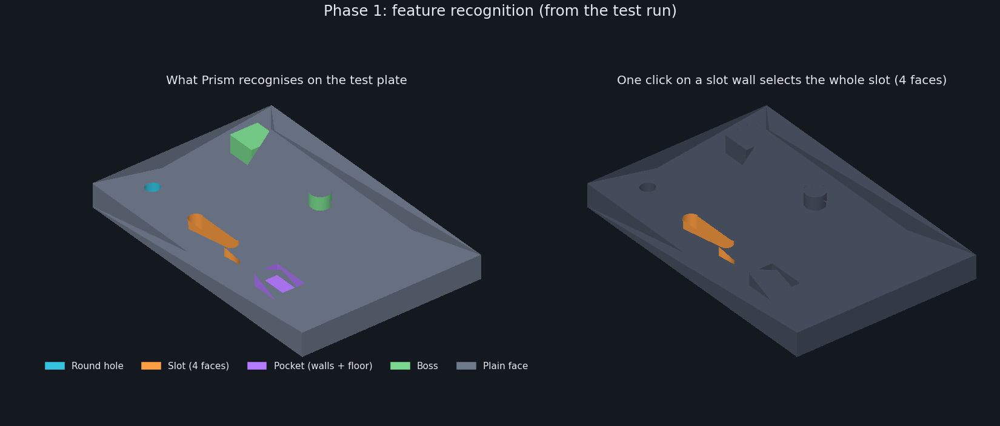
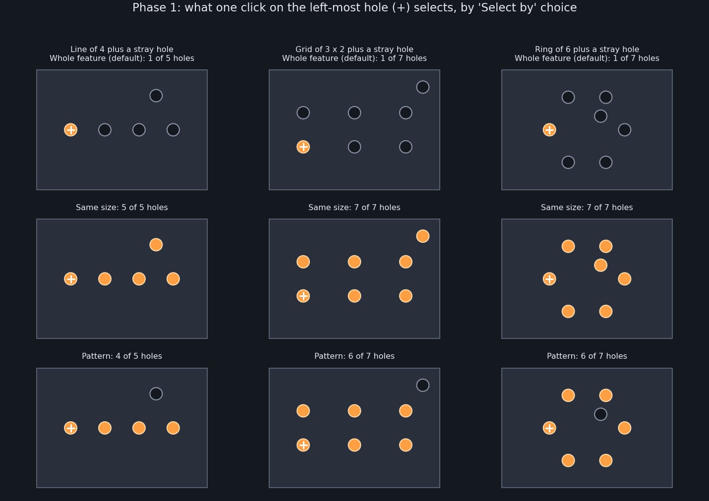
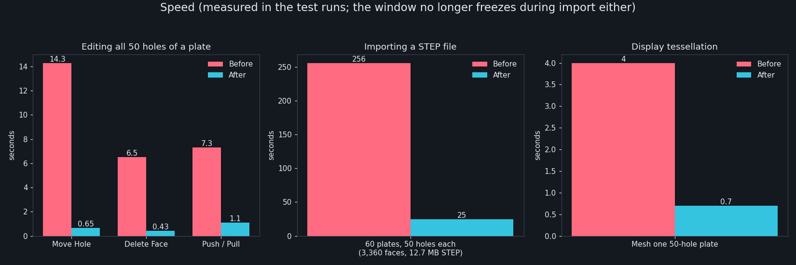

# Direct modeling

Direct modeling edits the geometry you have, with no history needed. It works on any exact body, including parts imported from STEP, IGES or BREP. Open the **Direct Modeling** tab.

The tab reads left to right: **Select, Datum, Add, Edit faces, Edit features, Repair, Transform, Inspect, Appearance.**

- **Add** makes new geometry: Hole, Fillet, Chamfer, Shell, Split Body.
- **Edit faces** changes existing faces.
- **Edit features** changes whole holes, slots, pockets, bosses, fillets and patterns.
- **Repair** checks and heals imported parts.

## Click a face, get the whole feature

Prism works out what each face belongs to. One click on any face of a hole, slot, pocket, boss, counterbore, countersink or fillet selects the whole feature. It also recognises features that repeat in a line, a grid or a circle.

Hovering a face previews what a click would select. The **Select by** choice in a tool's panel sets how far a click reaches:

| Select by | A click picks |
|---|---|
| Whole feature (default) | every face of the hole, slot, pocket, boss or fillet |
| Single face | just that face |
| Tangent chain | the face and the faces that blend smoothly into it |
| Same size | every feature of the same kind and size |
| Pattern | the features laid out in the same line, grid or circle |

Click a selected feature again to deselect it. A stray feature of the same size that is not part of the pattern is not included by **Pattern**.

## Edit faces

| Tool | What it does |
|---|---|
| Push / Pull | Drag flat faces, whole holes or bosses out or in. |
| Move Face | Slide and tilt flat faces; the body stretches to follow. |
| Offset Face | Move every picked face along its own normal. |
| Rotate Face | Turn flat faces about an edge or axis. |
| Replace Face | Make faces lie on another plane or face. |
| Extend / Trim Face | Grow or shrink a face until it meets a target. |
| Match Face | Give faces the plane, cylinder radius or cone angle of a source face. |
| Draft | Lean walls away from a pull direction. |
| Split Face | Divide a face along a plane, edge or sketch. |
| Merge Faces | Join neighbouring faces that lie on the same surface. |
| Delete Face | Remove faces and let the neighbours close the gap. |

## Edit features

**Edit Feature** takes a picked hole, slot, pocket, boss or fillet and offers:

- **Move** by X, Y, Z, with a drag arrow in the view.
- **Copy**: a number of copies at a spacing.
- **Resize**: a round hole or boss diameter, a slot's width and length, or a straight fillet's radius.
- **Change type**: a hole becomes plain, counterbore or countersink.
- **Delete**: the feature goes and the gap closes.

The panel only shows what applies to what you picked.

Other tools in the group:

- **Edit Pattern**: change a line, grid or circle's spacing or count, or drop one instance.
- **Mirror Feature**: copy features across a plane or flat face.
- **Remove Fillets**: remove picked fillets, or every round up to a radius.
- **Edit Freeform**: shape a Freeform body by its cage.
- **Move Body**: move or turn a body while keeping a face flush, two holes coaxial or a round face tangent.

**Delete key and right-click.** With faces selected and no tool open, **Delete** removes the feature those faces belong to, not the whole body, and it is one undo step. Right-clicking offers what fits: select the whole feature or pattern, move, copy, resize, change hole type, delete. A plain face offers Push / Pull, Move Face and Delete.

## Repair

- **Check and Repair** reports open edges, tiny or sliver faces, duplicates and bad edges on an imported body, then heals, sews or cleans it.
- **Fill / Cap** closes an open loop of edges with a flat face or a smooth patch.

## Speed

Edits that touch many features apply their changes in one step instead of one per feature, and imports read and mesh on background threads.

## Scripting

Every tool is available from the scripting API and the MCP bridge by its command name; `list_commands` shows them. Scripts pick faces explicitly (for example with `solid_find`), so pass the faces of every feature you want changed.
