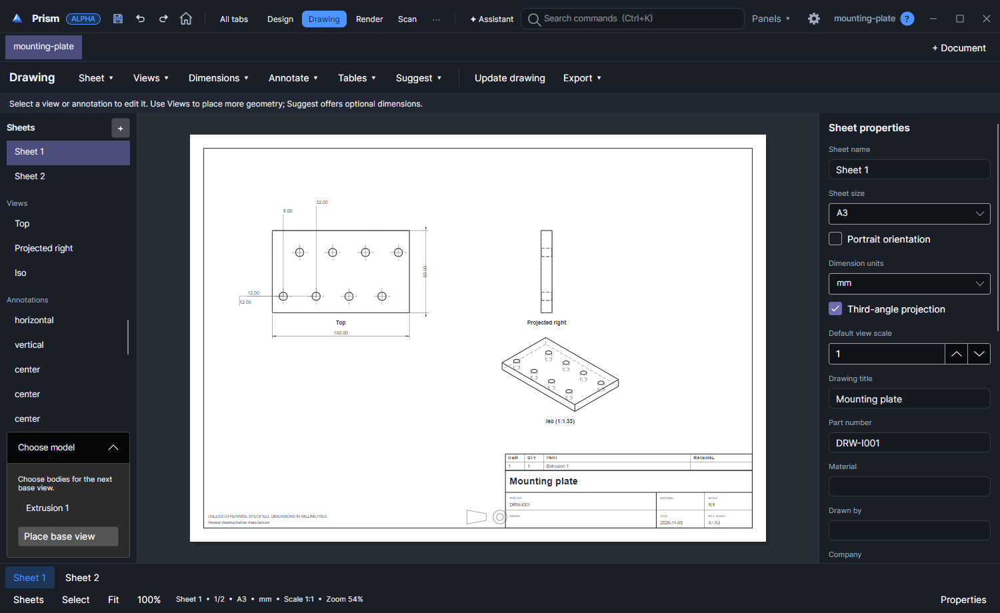

# Drawing verification evidence

Canonical feature guide: [Drawing workspace](../README.md). Delivery: [issue #58](https://github.com/chrizpro/prism/issues/58).

## Source and environment

Drawing source revision: [`1849f665db6b752b769379560c00a71dd781bdfd`](https://github.com/chrizpro/prism/commit/1849f665db6b752b769379560c00a71dd781bdfd). Verified on 2026-11-05 on the configured Windows workstation with .NET SDK 10.0.102 and installed OCCT binaries, without rebuilding native code. This was not cloud validation. Unrelated local reporting, native and modeling changes were preserved; full-suite counts include tests outside this Drawing commit. Drawing source and tests correspond to the pinned revision. [Machine-readable results and kernel hash](verification.json) record the relevant individual cases and desktop run IDs.

## Executed checks

- Full Unit suite: **95 passed, 0 failed, 0 skipped**, including **10 Drawing cases** (`DRW-U001` through `DRW-U010`). Command: `dotnet test Prism.Tests/Unit/Prism.UnitTests.csproj --no-restore`.
- Full Windows/OCCT Headless suite: **240 passed, 0 failed, 0 skipped**, including **8 Drawing cases** (`DRW-H001` through `DRW-H008`). Command: `dotnet test Prism.Tests/Headless/Prism.HeadlessTests.csproj --no-restore`. The full run preceded the final caption-spacing-only fix; that fix is covered by `DRW-U010` and the subsequent desktop export/render check.
- Desktop integration: **1 passed, 0 failed, 0 skipped**. `DRW-I001` runs the complete scenario twice, in Light and Dark themes: empty workspace, perforated plate, deliberate annotation acceptance, all 16 proposed hole-position dimensions for eight circles, selective acceptance, multiple views, two sheets, a section, save/reopen, suggestion deduplication and PDF/SVG/DXF export. Command: `dotnet test Prism.Tests/Integration/Prism.IntegrationTests.csproj --filter Feature=Drawing --no-restore`, with `PRISM_INTEGRATION_BIN` pointing at the isolated build.
- Release desktop and MCP builds passed. The desktop used `-p:IntermediateOutputPath=obj/DrawingReview/ -p:OutDir=<checkout>/artifacts/tests/drawing/bin/` to avoid another running process locking the normal Release intermediate assembly. Existing compiler warnings and the existing Tmds.DBus.Protocol package advisory were reported; no dependencies were changed.
- Additional manual pointer check: selected and dragged the 100 mm overall dimension; Ctrl+Z restored its previous placement. Picked two circle centers and placed a new horizontal dimension; the editor measured **24.00 mm**. This was an actual desktop interaction, separate from the MCP scenario, before the final caption-spacing-only correction. Its raw capture remains under `artifacts/tests/drawing/manual/`; it is not represented as a clean-source automated test.
- Export inspection: `pypdf` confirmed two A3 pages at **420 x 297 mm** with expected titles. Both pages were rendered with Poppler and inspected. Section letters and the parent caption are separated. SVG/DXF content checks passed in `DRW-I001`. These checks do not constitute a full external CAD import compatibility matrix.

Raw TRX/logs are under `artifacts/tests/drawing/`; desktop outputs are under `artifacts/tests/integration/DRW-I001-Light/` and `DRW-I001-Dark/`. Old failed iterations are retained there; [verification.json](verification.json) identifies the final passing runs. Maintained test code and its limits are linked from the canonical guide.

## Actual desktop captures - DRW-I001

[Empty workspace, light](empty-light.png) - [Empty workspace, dark](empty-dark.png).

[Reopened drawing, light](workspace-light.png) - [Reopened drawing, dark](workspace-dark.png).

## Exported sheets - DRW-I001

[Two-page PDF](sample.pdf), [current-sheet SVG](sample.svg), [current-sheet DXF](sample.dxf).

[Rendered first PDF page](pdf-page-1.png) - [Rendered section page](pdf-page-2.png).

These images are verification records of this revision, not a promise of manufacturing completeness or full Fusion parity.
