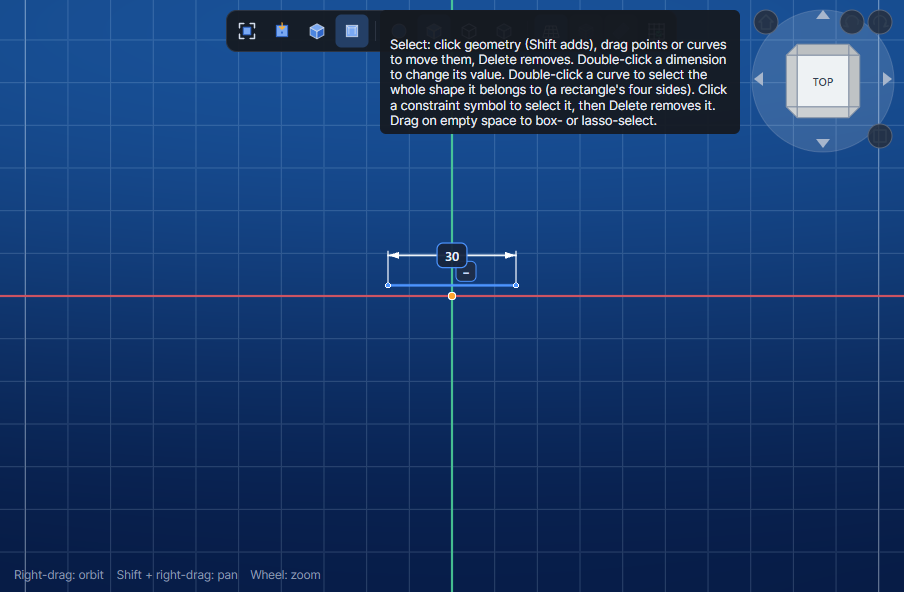
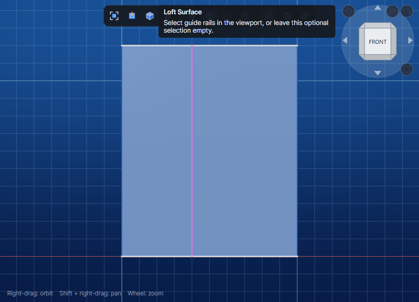
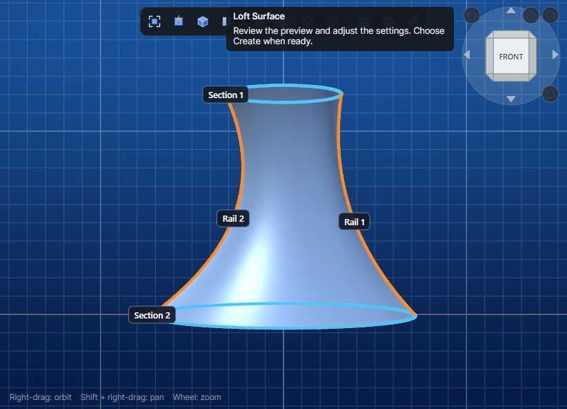

# Desktop integration evidence

These are Prism's viewport PNGs returned by the MCP screenshot tool during the scenarios in the [integration test project](../../Prism.Tests/Integration/README.md). The tests separately assert numeric geometry and document state. Window size, zoom and orientation can change when commands open or close their panels and focus the viewport.

Desktop and MCP were built from the Windows workstation checkout at [app source revision ac4efae](https://github.com/chrizpro/prism/commit/ac4efae69c8c6c6159b2476047806c45ed3a8e70) with its existing local changes and installed native binaries. The kernel was reused without a native rebuild. `prism_kernel.dll` SHA-256 is `07D37FF1F5F7E9F7E008801A919703CF6F49364BC20329207B97576A74CB7B19`.

## EXT-I001 · Extrude

The preview shows the 12 mm handle. The committed and redone solid measures 720 mm³ with 10 × 6 × 12 mm bounds. Undo restores the sketch-only state. The same test checks MCP tool discovery and rejection of unauthenticated and cross-origin HTTP calls.

[Profile](EXT-I001/01-profile.png) · [Commit](EXT-I001/03-committed.png) · [Undo](EXT-I001/04-undo.png) · [Redo](EXT-I001/05-redo.png)

## REV-I001 · Revolve

The preview shows the 90° handle. Forward and reversed solids each measure 42π mm³ and occupy opposite Y quadrants.

[Profile](REV-I001/01-profile.png) · [Forward](REV-I001/03-forward.png) · [Reversed](REV-I001/04-reversed.png)

## SFC-I001 · Control Grid and Thicken

The flat grid has 60 mm² of area. Thickening by 2 mm follows this grid's negative-Z normal and produces a solid of approximately 120 mm³. The volume assertion allows 0.01 mm³ for the kernel's spline result. Reopening the saved document preserves the geometry.

[Control Grid](SFC-I001/01-control-grid.png) · [Thickened](SFC-I001/02-thickened.png)

[Integration tracking issue #56](https://github.com/chrizpro/prism/issues/56)

The initial local Windows suite passed all 3 integration cases with zero failures or skips. This first set covers Solid Extrude and Revolve and a NURBS-to-solid document roundtrip. Assembly, CAE, CAM, and interactive viewport input are outside this set.

## Sketch constraints · SKT-I001

The API verifies the applied constraint type and entity reference, solver convergence, and the solved endpoints before and after adding a driving 30 mm line length. Both axis glyphs were visible in the desktop viewport. The images show the original oblique line, the applied constraint, and the dimension.

- Horizontal: [before](SKT-I001/horizontal/01-unconstrained.png) · [glyph](SKT-I001/horizontal/02-constraint.png) · [glyph and dimension](SKT-I001/horizontal/03-constraint-and-dimension.png)
- Vertical: [before](SKT-I001/vertical/01-unconstrained.png) · [glyph](SKT-I001/vertical/02-constraint.png) · [glyph and dimension](SKT-I001/vertical/03-constraint-and-dimension.png)

## Surface Loft · LFT-I001

Two straight sections produce a valid 120 mm² sheet with 10 × 0 × 12 mm bounds. The fixture is planar in both transition modes.

- Smooth: [sections](LFT-I001/smooth/01-sections.png) · [preview](LFT-I001/smooth/02-preview.png) · [commit](LFT-I001/smooth/03-committed.png)
- Ruled: [sections](LFT-I001/ruled/01-sections.png) · [preview](LFT-I001/ruled/02-preview.png) · [commit](LFT-I001/ruled/03-committed.png)

## Surface Sweep · SWP-I001

A three-edge profile on a straight path produces a valid 312 mm² sheet with 10 × 6 × 12 mm bounds in both orientation modes.

- Follow the path: [inputs](SWP-I001/follow/01-profile-and-path.png) · [preview](SWP-I001/follow/02-preview.png) · [commit](SWP-I001/follow/03-committed.png)
- Keep parallel: [inputs](SWP-I001/parallel/01-profile-and-path.png) · [preview](SWP-I001/parallel/02-preview.png) · [commit](SWP-I001/parallel/03-committed.png)

The six new cases passed locally through the same Windows Desktop/MCP build and kernel recorded above. Constraint application used MCP entity references. Picking glyphs, curved Sweep orientation, and guide-rail Loft remain open.

## Sketch rail visibility · LFT-I002

2026-11-05, Windows workstation, source based on `f6fd49e` plus the Loft rail visibility correction in this change. Rebuilt Release Desktop/MCP with installed native binaries. The maintained LFT-I002 scenario captures an unselected front-facing sketch rail inside the Surface Loft preview. LFT-H007 checks overlay geometry, picking/removal and hidden-sketch exclusion. The screenshot fixture uses a magenta rail to distinguish it from the grid axes; production preserves the sketch's own color.

The actual mouse check separately activated **Guide rails → Pick geometry**, clicked the rail, verified one slot item and an orange Rail 1 highlight, clicked again and verified an empty slot. These input steps were performed through computer use, not by the automated integration fact. This evidence establishes visibility/selection; it does not certify guided-loft shape accuracy or every rail layout.

[Picked orange rail](LFT-I002/02-picked-rail.png) · [Removed rail with hover highlight](LFT-I002/03-removed-rail.png) · [Canonical Loft guide](../modeling/loft/README.md#sketch-rails-obscured-by-the-preview)

## Curved ellipse loft · LFT-I003

2026-11-06, configured Windows workstation, source based on `4b7a96d` plus the geometry correction in this change. The owner approved this scope after reporting a surface pulling away from its rails and an apparent freeze. The test recreates the elliptical sketches at Z=0/120 and two three-point spline rails, captures the preview using the Front and Iso presets, commits a valid surface with no solids, and saves a native model. The original live session remains open with its input selections.

Rebuilt the Release native kernel, Desktop and MCP. Kernel SHA-256: `7D2DF87887E695AB8C7ED1F313C156B5F6DA6887A00FD1C9313B251DF065D76C`. Final maintained runs passed **14 Loft Headless cases and 4 Loft Integration cases**, zero failures/skips. Commands: `dotnet test Prism.Tests/Headless/Prism.HeadlessTests.csproj -c Release --filter Feature=Loft` and `dotnet test Prism.Tests/Integration/Prism.IntegrationTests.csproj -c Release --filter Feature=Loft`, after rebuilding Desktop/MCP into `artifacts/tests/integration/bin`.

LFT-H008 checks both profile orders and both rail orders: maximum of 49 sampled gaps per rail 0.024618 mm; end-profile samples have zero measured gap. Builds took 0.646–0.748 s and display meshing 1.674–1.948 s with 6,770–9,692 triangles. The original exact-input diagnosis took 16.315 s to mesh 159,491 triangles and measured gaps up to 1.777 mm at 13 samples per rail. These sampling densities differ; neither result is a certified global maximum. Timing is local evidence, not a universal performance contract. LFT-H009 separately checks the analytic straight-rail square-frustum benchmark.

[Iso preview](LFT-I003/02-iso-preview.png) · [Committed surface](LFT-I003/03-committed.png) · [Canonical geometry scope and limitations](../modeling/loft/README.md#curved-rails-and-slow-preview-diagnosis)

The repeated-section approximation still has finite error between fitted planes. Arbitrary nonparallel sections, same-side or multiply crossing rails, continuity guarantees and general progress/cancellation are not certified by this fixture. No mouse picking was repeated for this geometry correction; LFT-I002 records the earlier separate mouse check.
