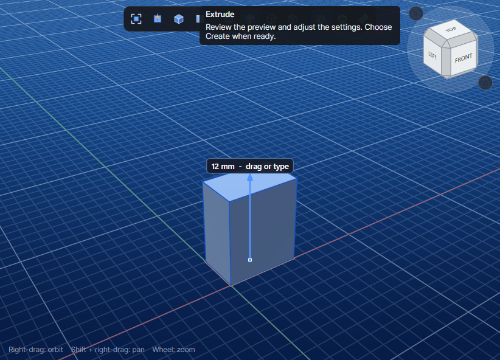
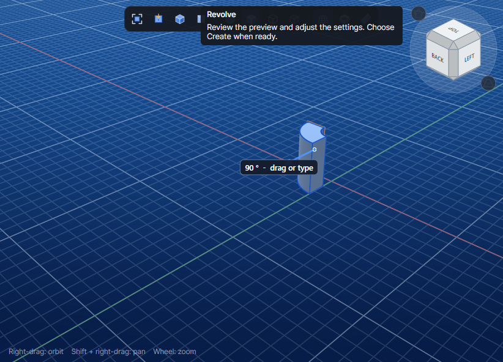
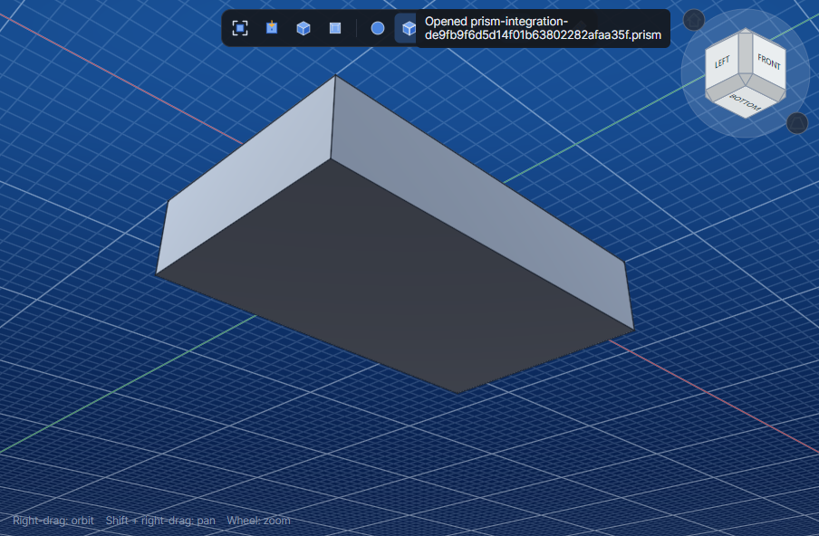

# Desktop integration evidence

These are Prism's viewport PNGs returned by the MCP screenshot tool during the scenarios in the [integration test project](../../Prism.Tests/Integration/README.md). The tests separately assert numeric geometry and document state. Window size, zoom and orientation can change when commands open or close their panels and focus the viewport.

Desktop and MCP were built from the Windows workstation checkout at [app source revision ac4efae](https://github.com/chrizpro/prism/commit/ac4efae69c8c6c6159b2476047806c45ed3a8e70) with its existing local changes and installed native binaries. The kernel was reused without a native rebuild. `prism_kernel.dll` SHA-256 is `07D37FF1F5F7E9F7E008801A919703CF6F49364BC20329207B97576A74CB7B19`.

## EXT-I001 · Extrude

The preview shows the 12 mm handle. The committed and redone solid measures 720 mm³ with 10 × 6 × 12 mm bounds. Undo restores the sketch-only state. The same test checks MCP tool discovery and rejection of unauthenticated and cross-origin HTTP calls.

[Profile](EXT-I001/01-profile.png) · [Commit](EXT-I001/03-committed.png) · [Undo](EXT-I001/04-undo.png) · [Redo](EXT-I001/05-redo.png)

## REV-I001 · Revolve

The preview shows the 90° handle. Forward and reversed solids each measure 42π mm³ and occupy opposite Y quadrants.

[Profile](REV-I001/01-profile.png) · [Forward](REV-I001/03-forward.png) · [Reversed](REV-I001/04-reversed.png)

## SFC-I001 · Control Grid and Thicken

The flat grid has 60 mm² of area. Thickening by 2 mm follows this grid's negative-Z normal and produces a solid of approximately 120 mm³. The volume assertion allows 0.01 mm³ for the kernel's spline result. Reopening the saved document preserves the geometry.

[Control Grid](SFC-I001/01-control-grid.png) · [Thickened](SFC-I001/02-thickened.png)

[Integration tracking issue #56](https://github.com/chrizpro/prism/issues/56)

The final local Windows run passed all 3 integration cases with zero failures or skips. This first set covers Solid Extrude and Revolve and a NURBS-to-solid document roundtrip. Assembly, CAE, CAM, and interactive viewport input are outside this set.
