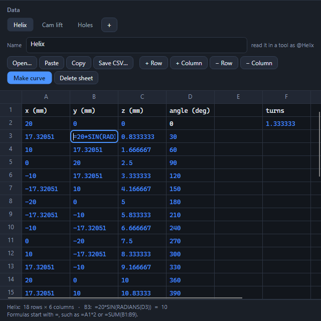

# Data panel

A small spreadsheet that lives in the document. It is saved with the file, and tools read its rows as points, positions or motion.

## Opening it

**Data Table** is in the View tab, in the Show section. The first time, it starts with one empty sheet. Sheets show as tabs at the top; **+** adds one, and the Name box renames it.

## Getting data in

- **Paste:** copy cells in Excel, click a cell, and press Ctrl+V (or the Paste button). A block of cells fills a block of cells. Pasting into an empty sheet fills it from the top.
- **Open…:** a CSV, TSV or text file, or an Excel workbook. Every sheet of a workbook comes in as its own sheet, with its name. Old .xls files are not read: save them as .xlsx or .csv first.
- **Typing:** click a cell and type. Enter moves down, Shift+Enter up, and Esc undoes what you typed.
- **A notepad file:** any plain table works: tabs, commas, semicolons or spaces between values. Quoted cells may contain the separator.

## Formulas

A cell that starts with `=` is a formula, shown in the accent color with its result:

`=A1*2`, `=SUM(B1:B9)`, `=20*COS(RADIANS(D2))`, `=B1+B2/4`

Cells and ranges, `+ - * / ^`, brackets, and SUM, AVERAGE, MIN, MAX, COUNT, ABS, SQRT, SIN, COS, TAN, ATAN2, RADIANS, DEGREES, EXP, LN, POWER, ROUND and PI. Errors show as `#DIV/0!`, `#NAME?`, `#VALUE!`, `#NUM!` or `#CYCLE!`. A cell shows seven digits; the full value goes to tools and files. Angles are in radians, as in Excel, so use RADIANS for degrees.

## Using a sheet in a tool

Type **@** and the sheet's name where a tool asks for a table or file:

| Tool | Where |
|---|---|
| Curve from Data | **Make curve** in the panel, or "…or read a file or sheet": a curve through x, y, z per row |
| Table Pattern | Positions: x, y, z and an optional angle per row |
| Motion Study | A joint's "Follow a table": time and position per row |

The same places also take the path of a CSV, text or Excel file, so a file can drive a model without being opened first. Rows at the top with no numbers, such as column names, are skipped.

## Limits

- No cell ranges to select or format, charts, or sorting.
- Tables are not an undo step. They are saved with the document.
- Cells are text; a number's format is not stored.