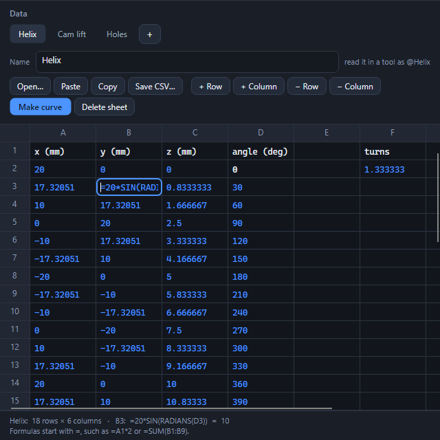

# Data panel

A small spreadsheet that lives in the document. It is saved with the file, and tools read its rows as points, positions or motion.

## Opening it

**Data Table** is in the View tab, in the Show section. The first time, it starts with one empty sheet. Sheets show as tabs at the top; **+** adds one, and the Name box renames it.

## Working in the grid

It behaves like a small spreadsheet (owner request 2026-11-14: the old panel looked right but was a column of separate text boxes).

- **Select, then type.** Click a cell to select it; typing replaces its contents, F2 or a double-click edits what is there, Enter and Tab move down and right (Shift reverses), and the arrows, Home, End, Page Up and Page Down move. Ctrl+arrow jumps to the edge of the data. Shift with any of those, or dragging, selects a block. Clicking a column letter or row number selects the whole column or row; the corner selects everything.
- **The formula bar** above the grid shows the selected cell's text (a formula, not its result) and takes an edit: type there and press Enter.
- **Copy, cut and paste blocks** with Ctrl+C, X and V. Pasted into Excel they arrive as values; pasted back into the panel, a formula moves with its cells (`=A1*2` copied one row down is `=A2*2`), and `$` pins a row or column as in Excel. Delete clears the selected cells.
- **Undo and redo** (Ctrl+Z, Ctrl+Y, or the buttons) go back through every change made in the panel: typing, paste, clear, sort, fill, adding and deleting rows or columns.
- **Fill down** (Ctrl+D or the button): select a block and the top cell repeats down it, formulas moving row by row. Type two numbers first, such as 1 and 2, and the series carries on (3, 4, 5…).
- **Sort ↑ / Sort ↓** order the rows by the selected column. Numbers sort as numbers, a first row of names stays at the top, and empty cells go last.
- **+ Row, + Column, − Row, − Column** insert before, or delete, the rows and columns the selection touches.
- **The picture below the grid** plots what is selected, so a column can be checked at a glance: one column against its row number, or several columns against the first. **The line at the bottom** gives the count, sum, average, smallest and largest of the numbers in a selected block.

## Getting data in

- **Paste:** copy cells in Excel, click a cell, and press Ctrl+V (or the Paste button). A block of cells fills a block of cells. Pasting into an empty sheet fills it from the top.
- **Open…:** a CSV, TSV or text file, or an Excel workbook. Every sheet of a workbook comes in as its own sheet, with its name. Old .xls files are not read: save them as .xlsx or .csv first.
- **Typing:** click a cell and type, as above.
- **A notepad file:** any plain table works: tabs, commas, semicolons or spaces between values. Quoted cells may contain the separator.

## Formulas

A cell that starts with `=` is a formula, shown in the accent color with its result:

`=A1*2`, `=SUM(B1:B9)`, `=20*COS(RADIANS(D2))`, `=B1+B2/4`

Cells and ranges, `+ - * / ^`, brackets, and SUM, AVERAGE, MIN, MAX, COUNT, ABS, SQRT, SIN, COS, TAN, ATAN2, RADIANS, DEGREES, EXP, LN, POWER, ROUND and PI. Errors show as `#DIV/0!`, `#NAME?`, `#VALUE!`, `#NUM!` or `#CYCLE!`. A cell shows seven digits; the full value goes to tools and files. Angles are in radians, as in Excel, so use RADIANS for degrees.

## Using a sheet in a tool

Type **@** and the sheet's name where a tool asks for a table or file:

| Tool | Where |
|---|---|
| Curve from Data | **Make curve** in the panel, or "…or read a file or sheet": a curve through x, y, z per row |
| Table Pattern | Positions: x, y, z and an optional angle per row |
| Motion Study | A joint's "Follow a table": time and position per row |

The same places also take the path of a CSV, text or Excel file, so a file can drive a model without being opened first. Rows at the top with no numbers, such as column names, are skipped.

## Limits

- No cell formatting, merged cells or charts beyond the quick picture. Rows and columns cannot be resized or dragged to reorder (sort the rows instead).
- Undo steps are the panel's own and are not kept when the document is saved and reopened; the tables themselves are saved with the document.
- Selecting several cells and typing fills only the active cell. Use fill down to repeat a value.
- Maintained checks: [DAT-U001 to DAT-U006](../../../Prism.Tests/Unit/Data/DataSheetEditTests.cs) cover formula moving, sorting, fill, statistics and snapshots. The drawn grid itself (selection, typing, clipboard) has no automated test and has not been tried by hand yet.
- Cells are text; a number's format is not stored.