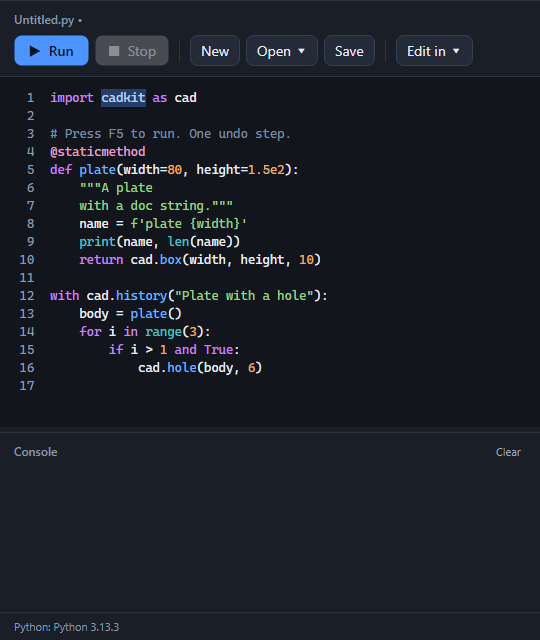

# Script

- **Write:** Script Editor (shows or hides the panel), New Script, Run Script
- **Your own editor:** VS Code, PyCharm, Scripts Folder

The panel shows the script's name, then Run and Stop, New, Open and Save, and Edit in (VS Code, PyCharm, Scripts folder). Below that are the editor, a console you can resize, and a status line. Python is colored as you type; a file over 200,000 characters stays plain so typing never lags.

