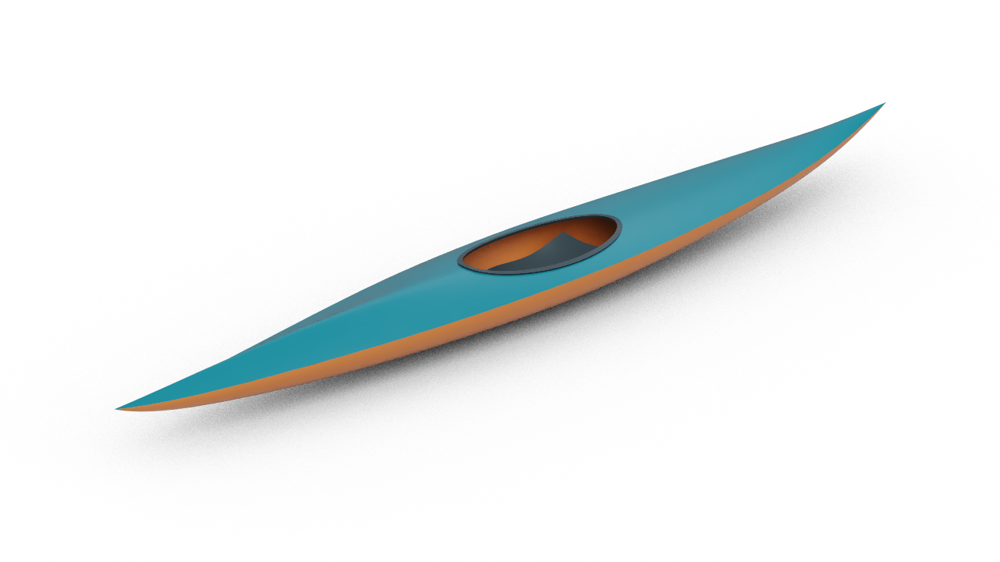

# Kingfisher kayak

A 4.75 m kayak built on Windows using the Prism desktop, the stdio MCP bridge and cadkit. The [native model](Kingfisher.prism) contains a copper hull, a teal deck, a solid cockpit coaming and a molded seat. The three skins are individual open surfaces. This is a shape study.

## Build and inspect

Run `python gallery/build_kingfisher.py` from the checkout with local Desktop and MCP builds available. Set `PRISM_EXE` and `PRISM_MCP` to use another local desktop executable and bridge DLL. The [builder](../../gallery/build_kingfisher.py) starts an isolated session, builds a new document, writes the study files here, reopens the native model, checks all four objects and renders the result.

Eleven transverse splines set the hull beam, keel rocker, sheer height and deck crown. The forward deck sections concentrate curvature near the centerline. The sections become rounder before the cockpit. A vertical elliptical cutter opens the deck. A narrower annular band trimmed from the same deck shape makes the coaming, and six transverse splines form the scooped seat.

## MCP observations

- A successful in-place trim returns an empty `created` list. Its `changed` entry reported a 289,082.69 mm² reduction in deck area and an edge count change from four to five. Read the full `run_command` response when editing an existing shape.
- A length-filtered `solid_find` query on the trimmed deck isolates the 2,117.21 mm opening edge. A 13 mm constant-radius capped Pipe on that edge reported completion and returned an invalid solid. The delivered coaming uses the valid thickened-band construction. [Pipe issue #49](https://github.com/chrizpro/prism/issues/49)
- At X = 1,700 mm the tessellated profile measured a beam of about 311.5 mm against a nominal 312 mm. On open skins, signed segment sums can give a negative area. Use the extents to judge beam and rocker. The [inspection results](inspection.json) retain the original numbers.
- The [reopen integration case](../../Prism.Tests/Integration/KingfisherStudyTests.cs) checks length, the trimmed opening and the coaming's solid validity and positive volume. Run the desktop integration project with `--filter TestId=SFC-I002`. See the [MCP guide](../MCP.md) and [Surface Loft guide](../modeling/loft/README.md).

Windows study base: local v0.4-work at `1bb8114`, including CAM setup change `38fc8e9`.

## Windows verification, 2026-11-17

API-I001 ran the shipped Python library through MCP run_script. A circular cut in a planar loft removed the expected area within 0.01 mm². SFC-I002 reopened the kayak through the bridge and found the measured cockpit edge and a valid solid coaming. The 35 existing cadkit Python tests also passed. Desktop and bridge Release builds used the workstation's existing native DLLs.

A full solid_check on the coaming exceeded the bridge's 360-second timeout. The workstation reproduced the timeout in the study script and in a separate desktop integration session. object_info returns validity, bounds and volume without the additional center-of-mass calculation. The [top and side viewport sheet](plan.png) and [Prism render](overview.png) show the saved geometry.
