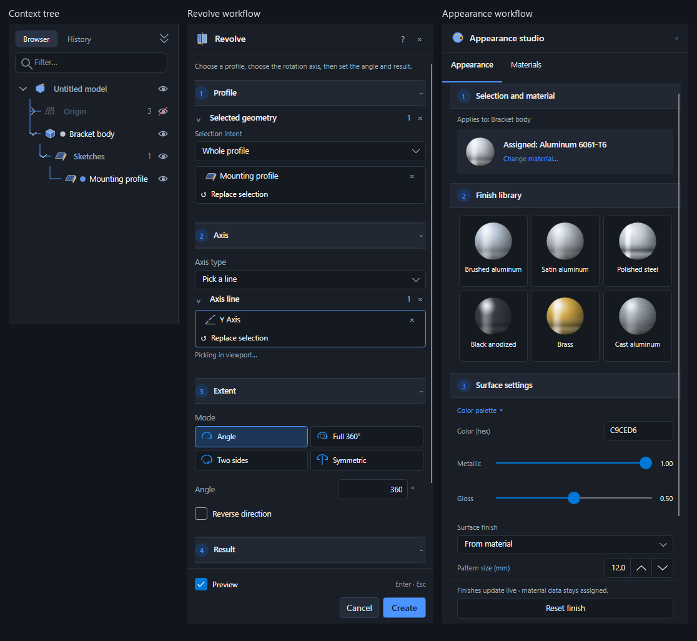

# Consistent panel workflows

The model browser is a native, collapsible tree. Its connector overlay uses the dynamic `Accent` resource, preserving keyboard navigation, multi-selection, visibility toggles, and context menus. Available feature recipes associate source sketches, curves, and planes with the body that uses them; unrelated geometry stays in type folders. Expansion uses object IDs, so renaming a body does not lose its disclosure state. Filtering retains ancestors.

`CommandSection` groups the existing command inputs for presentation without changing parameter or recipe indices. Commands with no special grouping use one section per input, then Settings and Result. Revolve explicitly groups axis type and axis line into step two. Extrude groups extent-dependent pickers and values. Sections are collapsible. `PanelStepHeader` shares the same numbering treatment with Appearance, Properties, and Simulation. Studios use the application theme resources rather than a separate accent palette.

Selection intent expands picks to concrete B-rep edges. Connected chains stop at junctions; tangent chains additionally stop when sampled end tangents differ by more than five degrees. Partial loops require a simple chain without junctions and use explicit first/last edges with an alternate path. These rules operate on the picked object's edges. Their results are concrete selections, not associative rules that automatically follow future topology changes. Surface Extrude and Revolve accept open chains; solid tools require all selected wires to form planar faces.

Run `dotnet run --project tests/Prism.PanelWorkflowTests -c Release` from the repository root. It exercises real geometry and generates the accompanying dark/light panel screenshots using Avalonia's renderer. These are rendered application controls, not mockups. The test also checks an alternate preference accent without saving preferences.

## Screenshots

| Panel | Dark | Light |
| --- | --- | --- |
| Context tree | [View](context-tree-dark.png) | [View](context-tree-light.png) |
| Extrude | [View](extrude-steps-dark.png) | [View](extrude-steps-light.png) |
| Revolve | [View](revolve-steps-dark.png) | [View](revolve-steps-light.png) |
| Three selected edges | [View](extrude-three-edges-dark.png) | [View](extrude-three-edges-light.png) |
| Partial loop and alternate path | [View](partial-loop-selection-dark.png) | [View](partial-loop-selection-light.png) |
| Appearance | [View](appearance-dark.png) | [View](appearance-light.png) |
| Properties | [View](properties-dark.png) | [View](properties-light.png) |
| Simulation | [View](simulation-dark.png) | [View](simulation-light.png) |
| Sketch | [View](sketch-dark.png) | [View](sketch-light.png) |
| Diagnostics | [View](diagnostics-dark.png) | [View](diagnostics-light.png) |
| References | [View](references-dark.png) | [View](references-light.png) |
| Parameters | [View](parameters-dark.png) | [View](parameters-light.png) |
| Parts library | [View](parts-library-dark.png) | [View](parts-library-light.png) |

The [alternate-accent capture](context-tree-purple.png) verifies that branches change with Preferences rather than hardcoding blue.

## Validation

344 checks passed across PanelWorkflowTests, StudioPolishTests, StudioTests, HistoryTests, SketchModeTests, ProjectionTests, and WorkflowTests. The desktop Release build succeeds. StudioPolishTests now selects the Fillet radius by label instead of assuming that Fillet has only one numeric field.
