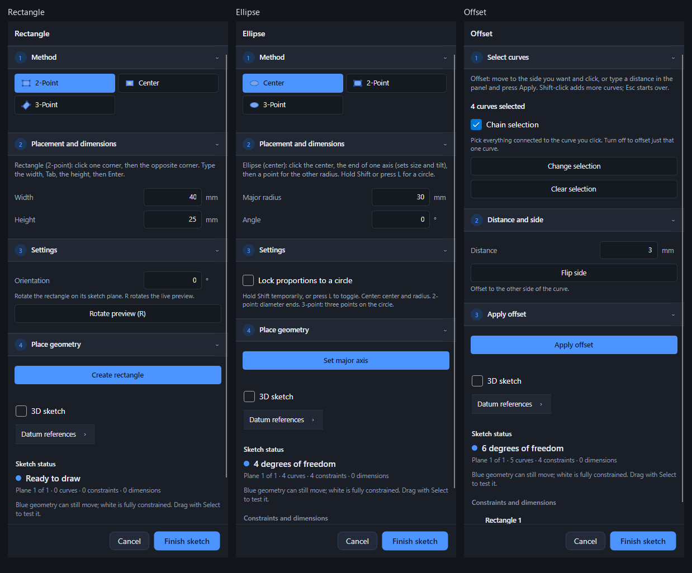

# Sketch-tool panel consistency

The shared `SketchPanel` renderer now covers every concrete `SketchTool` family. Options use one method chooser, geometry instructions and live values share an input section, settings follow, and placement/apply actions come last. Sections reuse `PanelStepHeader`, the same component as the modeling commands and other studios. Theme and accent colors come from the application resources.

Rectangle uses Method → Placement and dimensions → Settings → Place geometry. Ellipse uses the same sequence, exposing its axis/radius fields when the drawing step is ready. Offset uses Select curves → Distance and side → Apply offset; distance and side controls are disabled until selection is complete.

Tool metadata assigns controls to their section without duplicating views. Tools with no custom options still show geometry guidance. Stable section, method, and row objects preserve collapsed state and keyboard focus through live refreshes. Fields retain in-progress or invalid text until committed, report invalid numbers inline, and cannot commit to a different tool after a switch. Placement labels describe the actual next action, such as Set major axis or Create rectangle.

## Coverage and screenshots

The [complete gallery](gallery.md) and [machine-readable inventory](inventory.json) cover 21 concrete tool types and 64 variants, including all 12 supported constraint types, drawing methods, and boolean construction variants. Each has a screenshot in both themes.

- Rectangle: [dark](rectangle-dimensions-dark.png), [light](rectangle-dimensions-light.png)
- Ellipse: [dark](ellipse-dimensions-dark.png), [light](ellipse-dimensions-light.png)
- Offset: [dark](offset-selected-dark.png), [light](offset-selected-light.png)

`dotnet run --project tests/Prism.SketchPanelWorkflowTests -c Release` regenerates the inventory and screenshots. Its 341 checks audit every exposed method and control, consecutive steps, live-edit state, collapsibility, numeric feedback, narrow dock layouts, and actual rectangle/offset geometry created through the shared actions. These are captures of implemented Avalonia controls, not design mockups.

The existing SketchModeTests (109 checks), ProjectionTests (34), PanelWorkflowTests (20), and WorkflowTests (43) also pass. The separate SketchSpaceTests suite stops at its pre-existing expectation that entering 3D Edit Geometry leaves gizmo setup; the current implementation and SketchModeTests instead explicitly begin 3D geometry editing in setup. This panel change leaves that behavior and assertion unchanged.
