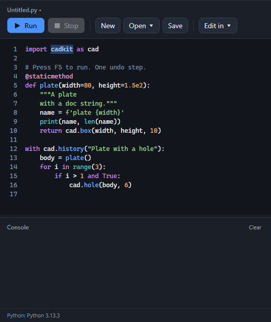

# Sheet Metal, ECAD and Script tabs

## Sheet Metal

- **Select, Datum:** shared sections
- **References:** Create Sketch, Construction Plane
- **Sheet metal:** Flange, Flat Pattern
- **Cut-outs:** Extrude, Hole, Fillet / Chamfer (dropdown)
- **Transform, Inspect, Appearance:** shared sections

## ECAD

Mechanical integration only: boards, component envelopes, fit checks and STEP exchange. It has no electrical design tools.

- **Select, Datum:** shared sections
- **References:** Create Sketch, Construction Plane
- **Board:** Rectangular board / Board from outline (dropdown), Mounting Hole
- **Components:** Component Envelope
- **Transform:** shared section
- **Mechanical checks:** Interference
- **Inspect:** shared section
- **Exchange:** Import STEP, Export STEP
- **Appearance:** shared section

## Script

- **Write:** Script Editor (shows or hides the panel), New Script, Run Script
- **Your own editor:** VS Code, PyCharm, Scripts Folder

The panel shows the script's name, then Run and Stop, New, Open and Save, and Edit in (VS Code, PyCharm, Scripts folder). Below that are the editor, a console you can resize, and a status line. Python is colored as you type; a file over 200,000 characters stays plain so typing never lags.

